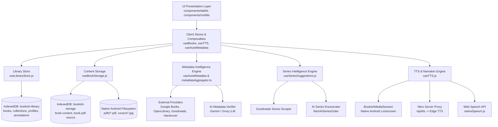
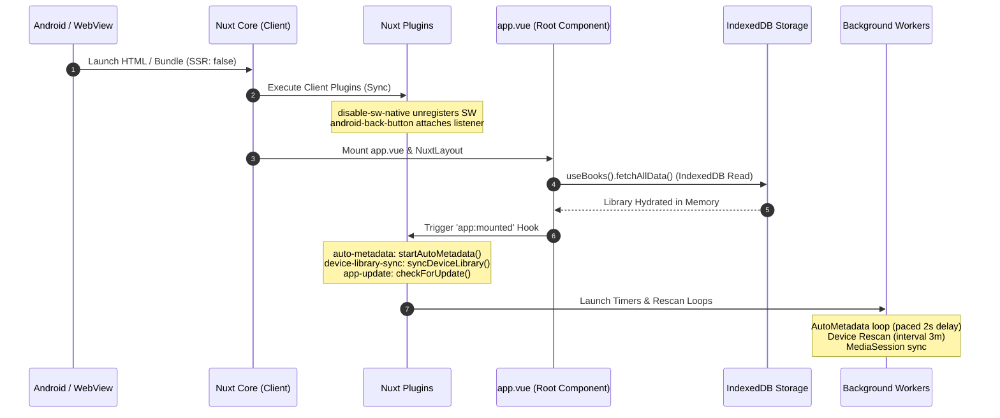

# Pages (Bookish): Complete Reverse-Engineered Master AI Knowledge Base & Architectural Interrogation Report

> **DOCUMENT PURPOSE**: This file is a comprehensive, single-file compilation of all 17 Architectural Interrogation Phases and Master Technical Specifications for **Pages** (formerly Bookish). It is formatted specifically for immediate sharing with AI models (such as ChatGPT, Claude, or Gemini) to provide near-project-level understanding of Pages without requiring access to the source code repository.

---

# Table of Contents
1. [Master System Overview & Architecture Diagrams](#1-master-system-overview--architecture-diagrams)
2. [Phase 1: Architecture & Lifecycle](#phase-1-architecture--lifecycle)
3. [Phase 2: Data Model & Storage](#phase-2-data-model--storage)
4. [Phase 3: Metadata Intelligence Engine](#phase-3-metadata-intelligence-engine)
5. [Phase 4: Series Intelligence Engine](#phase-4-series-intelligence-engine)
6. [Phase 5: Book Ingestion & EPUB/PDF Processing](#phase-5-book-ingestion--epubpdf-processing)
7. [Phase 6: Reader & Annotations Architecture](#phase-6-reader--annotations-architecture)
8. [Phase 7: Text-to-Speech (TTS) & Media Subsystem](#phase-7-text-to-speech-tts--media-subsystem)
9. [Phase 8: UI & Component Architecture](#phase-8-ui--component-architecture)
10. [Phase 9: Server API & Nitro Backend](#phase-9-server-api--nitro-backend)
11. [Phase 10: Android & Capacitor Native Integration](#phase-10-android--capacitor-native-integration)
12. [Phase 11: Search & Authors Subsystem](#phase-11-search--authors-subsystem)
13. [Phase 12: Security & Privacy Audit](#phase-12-security--privacy-audit)
14. [Phase 13: Performance & Scale Analysis](#phase-13-performance--scale-analysis)
15. [Phase 14: Testing & Regression Suite](#phase-14-testing--regression-suite)
16. [Phase 15: Build & Deployment Pipeline](#phase-15-build--deployment-pipeline)
17. [Phase 16: Technical Debt & Architectural Evolution](#phase-16-technical-debt--architectural-evolution)
18. [Critical Invariants, Failure Modes & Discovered Behaviors](#18-critical-invariants-failure-modes--discovered-behaviors)

---

# 1. Master System Overview & Architecture Diagrams

Pages is a local-first, mobile-native and PWA reading application built with **Nuxt 3 (Vue 3 + Nitro)**, **Capacitor**, and **IndexedDB**.

### Directory Structure & File Map

```text
Bookish/
├── android/                        # Native Android Gradle & Capacitor wrapper project
├── assets/                         # Global CSS/SCSS styles and theme variables
├── components/                     # Vue 3 UI components (split by target platform)
│   ├── desktop/                    # Desktop layout views (HomeDesktop, BooksDesktop, Sidebar)
│   ├── mobile/                     # Mobile layout views (HomeMobile, ReaderMobile, ReaderPagedEpub)
│   └── shared/                     # Cross-platform shared components & modal dialogs
├── composables/                    # Vue composables (state, storage, TTS, metadata hooks)
│   ├── tts/                        # TTS drivers (desktopTtsDriver, mobileTtsDriver, nativeSpeech)
│   ├── useAnnotations.js           # Sentence-chunk anchored highlights & notes
│   ├── useAutoMetadata.js          # Background metadata scraper & backfill loop
│   ├── useBooks.js                 # Central library store singleton (useState('library:books'))
│   ├── useBookStorage.js           # Low-level IndexedDB binary content & PDF storage
│   ├── useCoverImageCache.js       # Cover art downloader, local asset cache & self-healing
│   ├── useDeviceLibrarySync.js     # Native Android filesystem scanner & auto-import
│   ├── useEpubExtractor.js         # EPUB container unzipper, Dublin Core parser, CSS scoper
│   ├── useEpubPageMap.js           # ReadEra-style offscreen column pagination engine
│   ├── useLibraryStore.js          # IndexedDB store wrapper for books, collections, profiles
│   ├── useSeriesSuggestions.js     # Roster-driven series engine & AI gap verifier
│   └── useTTS.js                   # Narration engine, pre-fetcher & silent WAV keep-alive track
├── docs/superpowers/               # Specs and migration milestone documentation
├── layouts/                        # Application page wrappers (default.vue, reader.vue)
├── pages/                          # Nuxt file-based routing views
│   ├── index.vue, books.vue, reader/[id].vue, series.vue, settings/
├── plugins/                        # Nuxt client-side runtime plugins
│   ├── android-back-button.client.js, auto-metadata.client.js, device-library-sync.client.js
│   ├── disable-sw-native.client.js, media-session.client.js, app-update.client.js
├── server/                         # Nitro backend server engine & API endpoints
│   ├── api/                        # API endpoints (/api/books/metadata, /api/tts, /api/authors/bio)
│   ├── database/                   # Drizzle ORM schemas & SQL migrations
│   └── utils/                      # Metadata aggregator, AI verifier, Edge TTS proxy, scrapers
└── tests/                          # Vitest test suite & series-resolution audit benchmarks
```

### Complete System Architecture Diagram



---

# Phase 1: Architecture & Lifecycle

## 1. Architectural Overview & Major Subsystems

Pages comprises nine distinct major subsystems:
1. **UI & Navigation Layer** (`components/`, `pages/`, `layouts/`): Responsive presentation layer split strictly into `desktop/`, `mobile/`, and `shared/` components. Consumes Vue composables; handles user input, router navigation, and local reactive view rendering.
2. **Client State & Store Layer** (`composables/useBooks.js`, `useLibraryStore.js`): Reactive, in-memory library singleton (`useState('library:books')`). Bridges UI components with IndexedDB storage; orchestrates optimistic updates and rollbacks.
3. **Local Storage Layer (IndexedDB)** (`composables/useBookStorage.js`): Local-first persistence engine (`localforage` / IndexedDB). Stores book metadata, full EPUB/PDF binary blobs, cover image caches, and user reading progress.
4. **Metadata Intelligence System** (`composables/useAutoMetadata.js`, `useBookMetadataSearch.js`, `server/utils/metadataAggregator.ts`): Automated background scraper and multi-source aggregator (Google Books, OpenLibrary, Internet Archive, Goodreads). Cross-verifies candidates before patching empty book fields.
5. **Series Intelligence System** (`composables/useSeriesSuggestions.js`, `server/utils/aiSeriesEnumerator.ts`): Roster-driven series engine. Resolves reading order, missing series volumes, phantom titles, and series total alignment.
6. **Reader Subsystem** (`pages/reader/[id].vue`, `composables/useEpubExtractor.js`, `useEpubPageMap.js`): EPUB (epub.js / paged renderer) and PDF (pdf.js) rendering engine with line-by-line reading progress tracking and text selection.
7. **Text-to-Speech (TTS) Subsystem** (`composables/useTTS.js`, `composables/tts/`): Continuous narration engine supporting Web Speech API, Native Android Speech, and Server-side Edge TTS.
8. **Native Android Bridge (Capacitor)** (`android/`, `plugins/`): Native bridge for Android hardware back button, native device file imports, lockscreen media controls (`BookishMediaSession`), and APK self-updating.
9. **Nitro Backend Server & Proxy APIs** (`server/api/`, `server/utils/`): CORS proxies, cover image caching, server-side Edge TTS streaming, and AI metadata verification.

## 2. Complete Runtime Lifecycle (Startup to Shutdown)



### Execution Trace
1. **Engine Initialization**: `nuxt.config.ts` specifies `ssr: false` (SPA mode). On Android, Capacitor loads static assets directly from `public/` into the WebView.
2. **Plugin Boot Phase**: `disable-sw-native.client.js` unregisters any stale service worker caches on Android. `android-back-button.client.js` registers hardware back button listener with `@capacitor/app`.
3. **Root Vue Mount**: `app.vue` mounts. Reads format enablement settings from `localStorage`. `useBooks()` triggers `fetchAllData()` asynchronously, reading IndexedDB stores (`books`, `collections`).
4. **App Mounted Lifecycle Hook (`app:mounted`)**:
   - `opened-document.client.js`: Consumes any document passed via Android "Open With" intent.
   - `device-library-sync.client.js`: Hydrates series suggestions, schedules initial narrated device scan after 1500ms, and sets 3m recurring rescan.
   - `auto-metadata.client.js`: Runs database migration checks (`v2.0-instant-series-realign`), then invokes `startAutoMetadata()`.
   - `app-update.client.js`: Schedules sideloaded APK release check after 4000ms.
5. **Background Steady State**: `useAutoMetadata.js` runs continuously: pick target batch (3 books) -> search sources -> verify match -> patch IndexedDB -> cool down (busy: 5s, idle: 4m).
6. **Shutdown / Backgrounding**: When backgrounded, `visibilitychange` sets `visibilityState === 'hidden'`. Timers skip executions; `autoMetadata` adapts cooldown to `BACKGROUND_COOLDOWN_MS` (4 mins).

---

# Phase 2: Data Model & Storage

## 1. Primary Entities & Schema Definition
Data persistence is handled by two distinct IndexedDB databases: `bookish-library` (version 3) and `bookish-storage` (version 2).

### Entity 1: `Book` Record
- `id`: `string` (UUID) - Unique immutable primary identifier (`crypto.randomUUID()`).
- `title`: `string` - Title of the book.
- `author`: `string` - Author name string.
- `series`: `string` (Optional) - Canonical series name.
- `seriesInstallment`: `number` / `string` (Optional) - Volume/ordinal number in series (e.g. `1` or `1.5`).
- `seriesTotal`: `number` (Optional) - Total count of books in the resolved series.
- `seriesChecked`: `boolean` - Flag indicating if series metadata has been looked up.
- `cover`: `string` - Cover image URL, base64 data URI, or local asset path.
- `coverSource`: `string` - Recovery pointer for remote cover image URL.
- `description`, `publisher`, `publishedDate`, `isbn`, `genre` / `genres`.
- `status`: `"Unread"`, `"Reading"`, `"Read"`.
- `progress`: `number` (0 to 100).
- `lastReadAt`: `string` (ISO) - Timestamp stamped on reading scroll/swipe.
- `isFavourite`, `isHidden`, `goodreadsRating`, `metaCheckedAt`, `metaErrorCount`, `createdAt`, `updatedAt`.

### Entity 2: `Collection` (Playlist) Record
- `id`: `string` (UUID), `name`: `string`, `bookIds`: `string[]`, `createdAt`, `updatedAt`.

### Entity 3: `BookContent` Record (IndexedDB `bookish-storage` -> `book-content`)
Keyed out-of-line by `bookId`: `content` (extracted text/HTML), `pages` (count), `tocItems`, `format` (`"epub"` or `"pdf"`), `pdfManifest`.

### Entity 4: `PdfSource` Record (IndexedDB `bookish-storage` -> `book-pdf-source`)
Keyed out-of-line by `bookId`:
- Browser/PWA: Raw `ArrayBuffer` of full PDF file.
- Capacitor Native: Marker `{ __deviceFile: 'pdf' }` (actual bytes live on native filesystem under `pdfs/{bookId}.pdf`).

## 2. Vue Proxy Serialization Protection
IndexedDB structured clone algorithms throw a `DataCloneError` when attempting to store Vue 3 reactive proxies.
`useLibraryStore.js` protects every read/write via `toPlainRecord()`:
```javascript
export function toPlainRecord(value) {
  try {
    return JSON.parse(JSON.stringify(value))
  } catch {
    return value
  }
}
```

---

# Phase 3: Metadata Intelligence Engine

## 1. Multi-Provider Aggregation & Priority Rankings
Pages integrates **10 external metadata providers**: `hardcover`, `googleBooks`, `openLibrary`, `goodreads`, `kobo`, `publisher`, `wikidata`, `openAlex`, `libraryOfCongress`, `internetArchive`.

When providers present conflicting values for a field, the engine resolves conflicts using strict priority chains:
- **Cover Image Priority**: `hardcover` -> `googleBooks` -> `kobo` -> `openLibrary` -> `internetArchive` -> `goodreads` -> `publisher`.
- **Blurb Priority**: `hardcover` -> `googleBooks` -> `goodreads` -> `kobo` -> `publisher` -> `internetArchive` -> `openLibrary`.
- **Series Priority**: `hardcover` -> `goodreads` -> `wikidata` -> `kobo` -> `openLibrary` -> `googleBooks` -> `internetArchive`.
- **Publication Year Priority**: `openLibrary` -> `libraryOfCongress` -> `wikidata` -> `internetArchive` -> `googleBooks` -> `goodreads` -> `hardcover`.

## 2. Candidate Scoring Formula (`scoreSource`)
$$\text{Score} = S_{\text{ISBN}} + S_{\text{Title}} + S_{\text{Author}}$$
1. **ISBN Match**: Exact clean target ISBN match: $+100$ points.
2. **Title Match**: Exact normalized title: $+80$; Substring containment: $+55$; Token overlap: $\text{Math.round}(\text{Overlap} \times 45)$.
3. **Author Match**: Exact normalized author: $+35$; Substring containment: $+24$; Token overlap: $\text{Math.round}(\text{Overlap} \times 18)$.
4. **Author Compatibility Filter (`authorsCompatible`)**: Candidate is **rejected** if target and candidate author exist but share no substring overlap and token overlap $< 0.5$.

## 3. LLM Metadata Verifier Integration
When `BOOKISH_AI_PROVIDER` (or `GEMINI_API_KEY` / `GROQ_API_KEY`) is configured, candidates are passed to an LLM verifier (`gemini-flash-latest` or `llama-3.3-70b-versatile`):
- Temperature: `0` (Zero-shot JSON output mode).
- Rules: LLM is explicitly forbidden from inventing new facts. Rejects title-byline series (e.g. `"Dune by Frank Herbert"`), removes page noise blurbs (Cloudflare captchas), and assigns position confidence tags (`CONFIRMED` vs `INFERRED`).

---

# Phase 4: Series Intelligence Engine

## 1. Roster-Driven Totals Over Book-Level Totals Architecture
Standard metadata APIs overcount series length due to novellas, box sets, and foreign editions. Pages solves this through **Roster-Driven Totals**:
```javascript
export function reconcileEffectiveTotal({ contiguous = false, rosterMax = 0, claimedTotal = 0 }) {
  const claimed = Number(claimedTotal) || 0
  if (contiguous) return rosterMax
  if (rosterMax > 0 && claimed > rosterMax && claimed - rosterMax <= TRAILING_PHANTOM_MARGIN) {
    return rosterMax
  }
  return Math.max(rosterMax, claimed)
}
```
- **Contiguous Rule**: If a series roster is 100% contiguous ($1..M$), the roster max $M$ is **authoritative outright**, stripping all provider overcounts.
- **Trailing Phantom Margin (`TRAILING_PHANTOM_MARGIN = 2`)**: If claimed total sits $\le 2$ above roster max, excess is trimmed. Larger gaps ($\ge 3$) are preserved so missed roster pages don't hide real books.

## 2. Two-Tiered AI Placement Verification
When Goodreads is rate-limited (HTTP 202 on mobile webviews), an LLM proposes missing book titles (`fetchAiSeriesOrder`). LLM-proposed positions are verified via two tiers:
1. **Tier 1 (`confirmPlacement`)**: Live provider explicitly confirms candidate belongs to `seriesName` at integer volume $N$.
2. **Tier 2 (`yearFitsBetweenAnchors`)**: Candidate's publication year falls logically between surrounding confirmed anchor books in the series.

---

# Phase 5: Book Ingestion & EPUB/PDF Processing

## 1. EPUB Extraction Pipeline (`useEpubExtractor.js`)
1. Unpacks archive via `JSZip`.
2. Locates OPF manifest via `META-INF/container.xml`.
3. Parses Dublin Core XML tags (`dc:title`, `dc:creator`).
4. Converts all manifest images into base64 Data URLs in 8KB chunks.
5. Selects cover art (EPUB3 `properties="cover-image"`, EPUB2 `<meta name="cover">`, or fallback first image).
6. Scopes CSS rules under `.epub-content` wrapper to prevent styling bleed into Vue UI.
7. Parses TOC titles from EPUB3 `<nav>` or EPUB2 `.ncx` documents.
8. Joins chapter HTML with `<hr class="chapter-break"/>` and estimates pages ($\text{textLength} / 1500$).

## 2. PDF Ingestion & Filesystem Offloading
- **Web / PWA**: Full PDF binary stored in IndexedDB (`book-pdf-source`).
- **Android Native**: PDF binary saved to native filesystem under `pdfs/{bookId}.pdf`. IndexedDB retains only a lightweight marker `{ __deviceFile: 'pdf' }`. On open, resolves to native streamable URI (`assetWebSrc`).

---

# Phase 6: Reader & Annotations Architecture

## 1. ReadEra-Style Offscreen Column Pagination (`useEpubPageMap.js`)
- Measures real layout columns offscreen using actual viewport geometry (`width x height`), font family, size, and line height.
- Caches page maps in `localStorage` under `bookish:page-map:{bookId}:{w}x{h}:{hash}:{count}` (Version 2).
- Limits cache to 12 most recent maps via LRU pruning (`prunePageMapCache`).

## 2. Sentence-Based Annotation Anchoring (`useAnnotations.js`)
- Highlights and notes are anchored to sentence chunk spans (`<span data-tts-chunk="N">`) rather than DOM offsets.
- Stored entity includes `startChunk`, `startOffset`, `endChunk`, `endOffset`, highlighted text, color, and optional note string.
- `paintAnnotations(root, list)` wraps target chunk text ranges in `<mark data-annotation-id="..." style="--annotation-tint: ...">` elements.

---

# Phase 7: Text-to-Speech (TTS) & Media Subsystem

## 1. Speech Driver Delegation (`useTTS.js`)
- **Desktop / Web**: `desktopTtsDriver.js` sends SSML request to Nitro server `/api/tts` endpoint. Endpoint connects to Microsoft Edge Neural Speech WebSocket, returning MP3 audio + word boundary events.
- **Mobile WebView**: `mobileTtsDriver.js` attempts direct Edge TTS synthesis; falls back to `nativeSpeech.js` (Web Speech API) on network failure or rate limiting.

## 2. Silent WAV Keep-Alive Loop
Android WebView suspends background processes when audio output stops between sentence chunks.
Pages runs a continuous **Silent WAV Keep-Alive Track** (0.5s 48kHz stereo silent WAV buffer) in the background during active narration sessions, keeping the native Web Audio hardware channel open.

## 3. Native MediaSession Controls (`media-session.client.js`)
Binds `useTTS` narration state to Android notification shade via `@capacitor/core` plugin `BookishMediaSession`. Handles lockscreen play, pause, skip, seek events, and corrects seekbar position drift every 8 seconds.

---

# Phase 8: UI & Component Architecture

## 1. Platform View Selection
- Enforces a hard split between landscape-tablet/desktop-style (`components/tablet/`) and mobile (`components/mobile/`) views.
- Desktop uses a persistent left-hand sidebar navigation drawer (`Sidebar.vue`).
- Mobile uses an iOS/Android style bottom navigation bar (`MobileBottomNav.vue`).

---

# Phase 9: Server API & Nitro Backend

## 1. Endpoint Summary
- `/api/books/metadata` (`GET`): Multi-source metadata search aggregator.
- `/api/books/series-books` (`GET`): Scrapes Goodreads series roster page.
- `/api/books/series-order` (`GET`): AI series volume ordering fallback.
- `/api/authors/bio` (`GET`): Scrapes author biography, birth/death dates, and notable works.
- `/api/tts` (`POST`): Edge TTS proxy route (`edgeTts.ts`).

---

# Phase 10: Android & Capacitor Native Integration

## 1. Native Integrations
- **App ID**: `com.bookish.pages`
- **Hardware Back Button**: Binds back button to Nuxt router; minimizes app at root paths (`/`, `/books`, `/series`).
- **Filesystem Offloading**: Heavy PDF binary blobs and cover images offloaded from IndexedDB to native storage (`pdfs/*.pdf`, `covers/*.jpg`).
- **Sideloaded APK Updater**: Checks release manifest URL on startup/resume and triggers native APK installation intent.

---

# Phase 11: Search & Authors Subsystem

## 1. Search Engine
- Searchable fields: `title`, `author`, `series`, `genre`, `description`, `isbn`, `publisher`.
- Normalization: `NFKD` diacritic stripping, lowercasing, non-alphanumeric punctuation removal.

---

# Phase 12: Security & Privacy Audit

## 1. Security Safeguards
- **Zip Slip Protection**: `extractEpub` validates `if (!opfPath || opfPath.includes('..')) throw new Error(...)`.
- **HTML Sanitization**: `sanitizeBookHtml()` strips `<script>`, `<iframe>`, and inline event handlers from EPUB chapters.
- **Privacy Boundaries**: 100% of reading progress, annotations, highlights, personal profiles, and book contents remain strictly local on the device.

---

# Phase 13: Performance & Scale Analysis

## 1. Memory & Storage Scaling
- In-memory library store (`useState('library:books')`) holds metadata records (1,000 books $\approx 5$ MB RAM; 10,000 books $\approx 50$ MB RAM).
- Heavy HTML/PDF content binaries are never loaded into the main library array.
- Background tasks enter 4-minute cooldown when `document.visibilityState === 'hidden'`.

---

# Phase 14: Testing & Regression Suite

## 1. Test Architecture (50+ Vitest Files)
- `deviceStorage.test.js`: IndexedDB binary storage and backup serialization.
- `autoMetadataPacing.test.js`: Backfill pacing, priority queues, exponential backoff.
- `mobileDesktopPurity.test.js`: Guarantees mobile components do not import desktop-only modules.
- `tests/series-resolution/`: Benchmark suite testing adversarial series metadata, shadow audits, and multi-book stress cases.

---

# Phase 15: Build & Deployment Pipeline

## 1. Release APK Generation
1. `npm run generate`: Compiles static Nuxt SPA bundle into `dist/`.
2. `npx cap sync android`: Copies `dist/` into `android/app/src/main/assets/public/`.
3. `scripts/generate-version-manifest.mjs`: Generates `version.json` release manifest.
4. Gradle release build & `scripts/sign-release-apk.sh` (signs APK with release keystore).

---

# Phase 16: Technical Debt & Architectural Evolution

## 1. Technical Debt Inventory
- **God Composables**: `useSeriesSuggestions.js` (1,271 lines) and `useBooks.js` (584 lines) combine scraping, storage, UI toasts, and state management in single files.
- **Duplicated Logic**: HTML stripping and text normalization functions are duplicated across `useTTS.js`, `useAutoMetadata.js`, and `metadataAggregator.ts`.

---

# 18. Critical Invariants, Failure Modes & Discovered Behaviors

### Critical System Invariants
1. **Local Data Isolation**: User reading progress, annotations, highlights, personal profiles, and full EPUB/PDF binary files **MUST NEVER** leave the client device.
2. **Vue Proxy Storage Protection**: All objects passed to IndexedDB transactions **MUST** be cloned via `toPlainRecord()` (`JSON.parse(JSON.stringify(v))`) to prevent Vue 3 reactive proxies from throwing `DataCloneError`.
3. **Strict Title/Author Match Requirement**: Background metadata enrichment **MUST NEVER** patch empty book fields unless `metadataResultMatchesBook()` confirms candidate title and author match the target book.
4. **No LLM Fact Invention**: LLM verifiers (`aiMetadataVerifier.ts`, `aiSeriesEnumerator.ts`) are **EXPLICITLY PROHIBITED** from asserting volume positions or book metadata not verified by deterministic provider scrapers or bracketed by publication year anchors (`yearFitsBetweenAnchors`).
5. **Roster-Driven Contiguous Totals**: If a series roster is 100% contiguous ($1..M$), the roster max $M$ **MUST OVERRIDE** all metadata provider `seriesTotal` numbers, eliminating trailing phantom cards.
6. **Sentence Chunk Isolation Across Chapter Breaks**: EPUB content chunking **MUST** be performed section-by-section (`splitContentSections`). Chunks must **NEVER** straddle `<hr class="chapter-break">` elements, guaranteeing index alignment with TOC titles.
7. **Native Service Worker Unregistration**: On native Android builds, `@vite-pwa/nuxt` service workers **MUST BE UNREGISTERED** on startup by `disable-sw-native.client.js` to prevent stale asset cache crashes following APK updates.

---
*End of Pages Master AI Knowledge Base Combined Document.*
